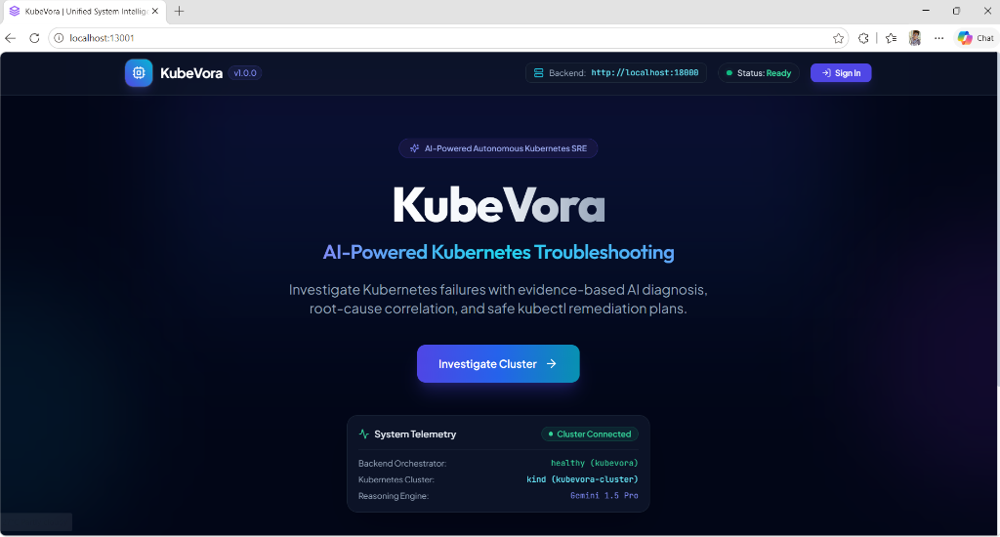
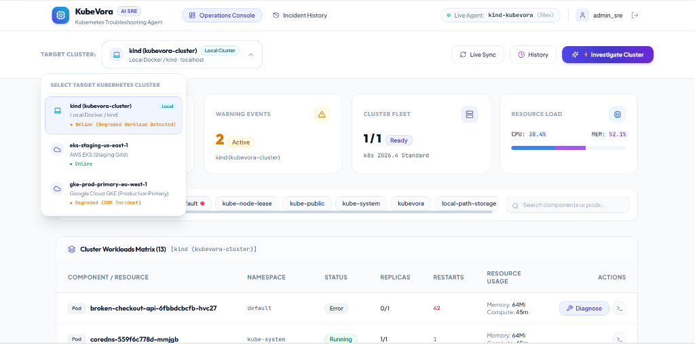
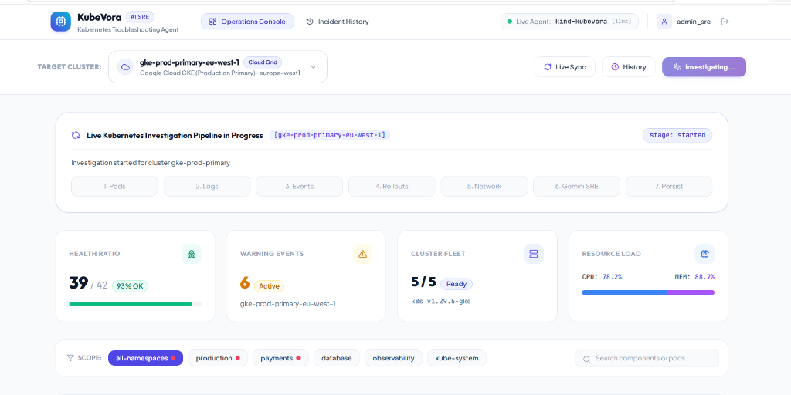
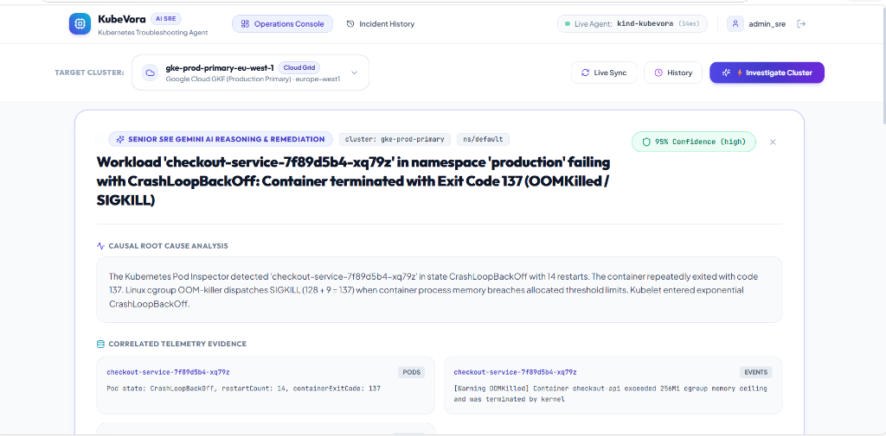
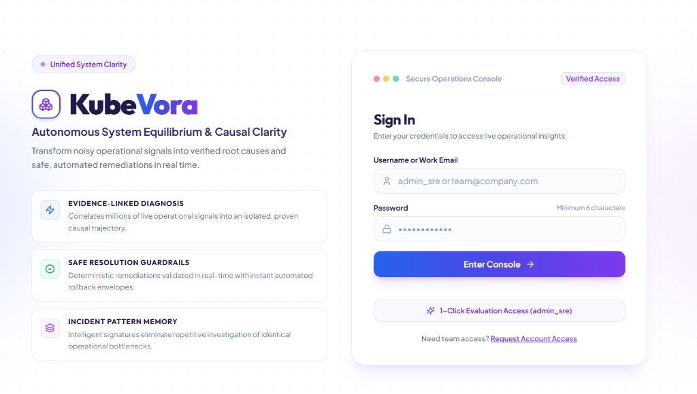

# KubeVora: AI-Powered Kubernetes Troubleshooting Agent

> An on-demand troubleshooting platform that investigates Kubernetes failures, collects cluster evidence, analyzes findings using Google Gemini, identifies potential root causes, and recommends safe fixes.



---

## 📸 Platform Showcase

| Multi-Cluster Workloads Matrix | Real-Time Investigation Pipeline |
| :---: | :---: |
|  |  |

| Senior SRE Gemini Diagnosis & Remediation | Secure SRE Console Access |
| :---: | :---: |
|  |  |

---

## 🏛️ System Architecture

```text
                    React Frontend (Vite)
                          |
                          v (REST / SSE)
                  FastAPI Backend
                          |
             +------------+-------------+
             |            |             |
             v            v             v
       Authentication  Investigation  History APIs
             |            |
             |            v
             |     Kubernetes Investigation Layer
             |     (Pods, Logs, Events, Rollouts, Network)
             |            |
             |            v
             |      Evidence Collection & Sanitizer
             |            |
             |            v
             |      Gemini AI Reasoning Engine
             |            |
             |            v
             |     Root Cause + Safe Fix Preview
             |            |
             +------------+
                          |
                          v
                  SQLAlchemy ORM
                          |
                          v
               PostgreSQL 16 Container
                          |
                          v
               Docker Named Volume (kubevora-postgres-data)
```

---

## 🚀 Quick Start with Docker Compose

Ensure Docker Engine and Docker Compose are installed and running.

### 1. Configure Environment Variables

Copy sample environment files:

```powershell
# In project root
Copy-Item .env.example .env
Copy-Item backend\.env.example backend\.env
Copy-Item frontend\.env.example frontend\.env
```

Ensure `backend/.env` has your Gemini API key (or leave empty for healthy cluster bypass / mock mode):
```env
GEMINI_API_KEY=your_gemini_api_key_here
GEMINI_MODEL=gemini-1.5-pro
```

### 2. Start Application Stack (PostgreSQL, FastAPI Backend, React Frontend)

```powershell
docker compose up --build -d
```

### 3. Verify PostgreSQL Health

Check that PostgreSQL container is running and healthy:

```powershell
docker compose ps
docker compose exec postgres pg_isready -U kubevora -d kubevora
```

### 4. Run Alembic Database Migrations

Apply the initial database schema to PostgreSQL:

```powershell
cd backend
alembic upgrade head
alembic current
cd ..
```

### 5. Access the Platform

- **Frontend Dashboard**: [http://localhost:3000](http://localhost:3000)
- **Backend API & Swagger Docs**: [http://localhost:8000/docs](http://localhost:8000/docs)
- **Health Check**: [http://localhost:8000/health](http://localhost:8000/health)

---

## 🔑 Authentication & SRE Access


KubeVora uses **FastAPI JWT authentication with Argon2 password hashing**.

### Default Seeded Administrator
- **Username**: `admin_sre`
- **Password**: `adminpassword123`

You can also register a new SRE user directly via the registration UI or the API:
```bash
curl -X POST http://localhost:8000/api/v1/auth/register \
  -H "Content-Type: application/json" \
  -d '{"username": "taylor_sre", "email": "taylor@devops.internal", "password": "strongPassword123!", "role": "Senior SRE"}'
```

---

## 🔍 Live Investigation & Streaming Progress


1. Log into the Dashboard at [http://localhost:3000/login](http://localhost:3000/login).
2. Select your target namespace (e.g. `default` or `production`).
3. Click **"Investigate Cluster"**.
4. The frontend connects to `POST /investigate/stream` using **Server-Sent Events (SSE)** and streams real-time stages:
   - `Checking Pods` → Detects `CrashLoopBackOff`, `OOMKilled`, etc.
   - `Collecting Logs` → Tails current logs and crash/previous logs.
   - `Analyzing Events` → Correlates Warning events.
   - `Inspecting Deployments` → Checks replica availability.
   - `Checking Network` → Validates selectors vs endpoints.
   - `Gemini SRE Reasoning` → Correlates evidence and formulates diagnosis.
   - `Persisting` → Saves report & incident fingerprint in PostgreSQL.


5. The **Diagnosis Console** presents:
   - Root cause & SRE explanation.
   - Supporting evidence list.
   - Suggested Safe Fix.
   - One-click copyable `kubectl` commands (strictly safe recommendations, never auto-executed).
   - Proposed YAML diff.
   - Diagnostic confidence score (0-100%).

---

## 📜 Historical Investigation Retrieval

Every investigation is associated with the authenticated user and persisted in PostgreSQL.
- Click **[History]** in the top navigation or visit `/history`.
- Retrieve past investigations even after browser/container restart.
- **User Isolation Security**: Users cannot view or modify other users' investigations (`HTTP 404` returned on unauthorized requests).

---

## 🏷️ Incident Fingerprinting

KubeVora automatically computes a deterministic incident signature:
$$\text{Fingerprint} = \text{SHA256}(\text{Namespace} + \text{ResourceKind} + \text{Workload} + \text{Category} + \text{NormalizedError})[:16]$$
- Normalizes pod random replica hashes (`pod-7b89f64c-xz92a` → `pod`).
- Normalizes timestamps and memory addresses.
- Automatically increments `occurrence_count` when a matching failure recurs, enabling MTTR tracking.

---

## 🗄️ Database Operations (PostgreSQL & Docker)

### Inspect Database Records

```powershell
docker compose exec postgres psql -U kubevora -d kubevora -c "SELECT id, namespace, status, root_cause, confidence, fingerprint_hash FROM investigations ORDER BY created_at DESC LIMIT 5;"
```

### Backup Database

```powershell
docker compose exec -T postgres pg_dump -U kubevora kubevora > kubevora_backup.sql
```

### Restore Database

```powershell
Get-Content kubevora_backup.sql | docker compose exec -T postgres psql -U kubevora -d kubevora
```

### Stopping vs Removing Data

- **Stop containers (Persists all data)**:
  ```powershell
  docker compose down
  ```
- **Restart containers (Data is retained)**:
  ```powershell
  docker compose up -d
  ```
- ⚠️ **CAUTION - Delete Database Volume (Destroys all persistent data)**:
  ```powershell
  docker compose down -v
  ```

---

## 🧪 Automated Testing

Run the complete test suite (25 tests covering Kubernetes inspection, Gemini reasoning, and PostgreSQL persistence):

```powershell
cd backend
python -m pytest tests/test_k8s_investigation.py tests/test_ai_reasoning.py tests/test_persistence.py -v
```

All tests mock subprocess calls and HTTPX requests, allowing the suite to run completely offline without an active cluster or consuming Gemini API quota.

---

## 🛣️ Progress Matrix

- [x] **Prompt 1: Project Setup & Foundation**
  - FastAPI backend orchestrator & Loguru logging
  - React 19 (Vite) frontend with Tailwind CSS
  - Multi-container Docker & Docker Compose setup
- [x] **Prompt 2: Kubernetes Investigation Engine**
  - Subprocess `kubectl` executor with RFC 1123 validation
  - Pod inspector, log tailer with `--previous`, event analyzer, deployment & network inspectors
  - `POST /investigate` evidence endpoint
- [x] **Prompt 3: AI Reasoning Engine with Google Gemini**
  - PromptBuilder with Senior SRE persona and anti-injection defenses
  - Gemini HTTPX client with exponential backoff on HTTP 429/503
  - Structured response validation & safe fix preview
- [x] **Prompt 4: Dashboard, API Integration & PostgreSQL Persistence**
  - PostgreSQL 16 container with Docker named volume
  - SQLAlchemy 2.x models (`User`, `Investigation`, `Finding`, `IncidentFingerprint`)
  - Alembic migrations
  - Live SSE progress streaming (`POST /investigate/stream`)
  - User-isolated investigation history (`GET /investigations`, `GET /investigations/{id}`)
  - React Dashboard with live stepper, safe fix preview, and History view

---

## 📄 License

This project is licensed under the MIT License - see the [LICENSE](LICENSE) file for details.
